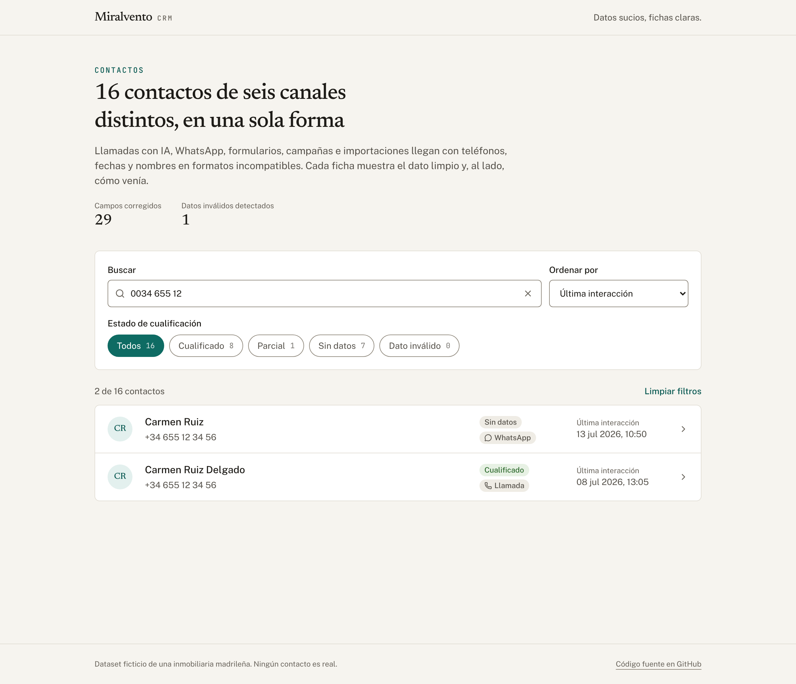
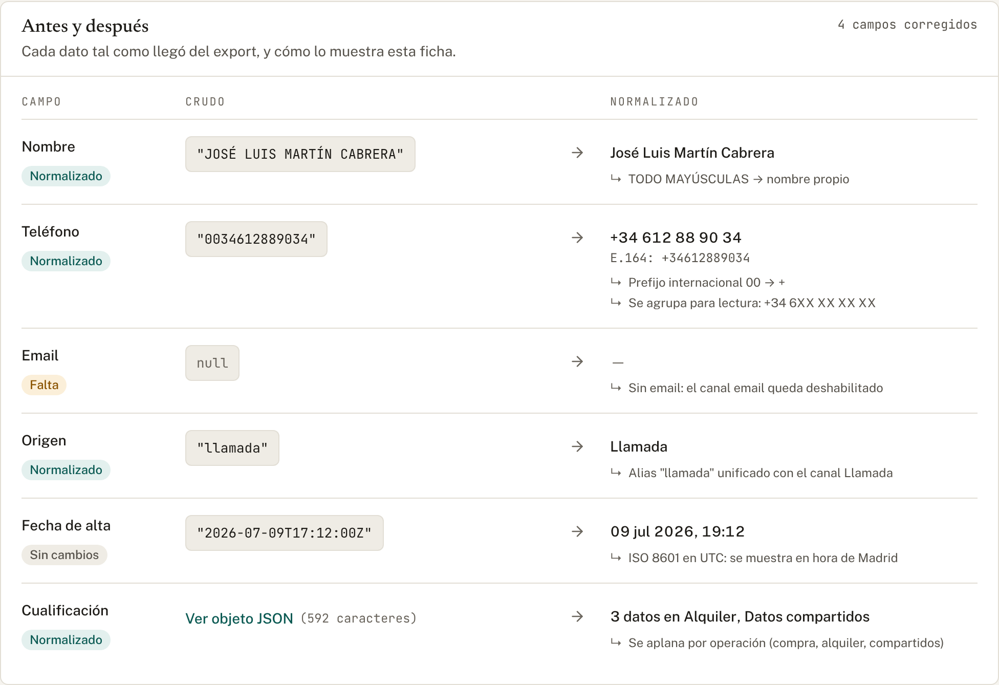
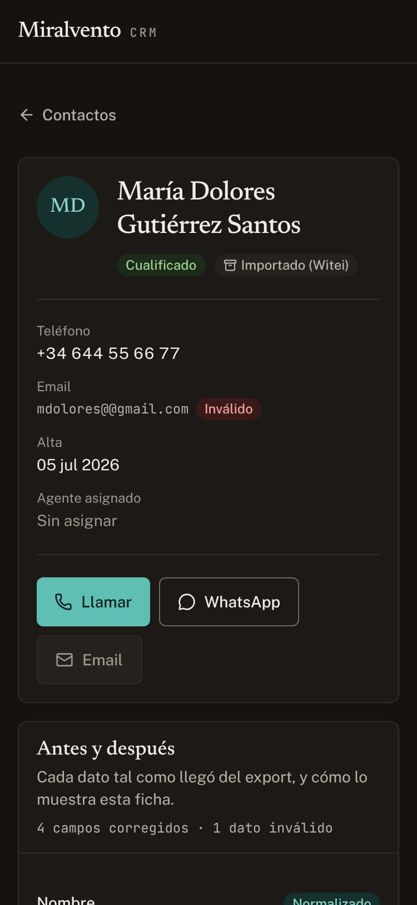

# Miralvento CRM

**Un CRM que convierte datos sucios en fichas claras.**

[](https://github.com/PVmendez/real-estate-crm/actions/workflows/ci.yml)

**Demo:** <https://miralvento-crm.nordicdevs.workers.dev> — desplegada en Cloudflare Workers con `npm run cf:deploy` (ver [Despliegue](#despliegue)).



## El problema

Una inmobiliaria recibe contactos por seis vías: un agente de voz con IA, WhatsApp, formularios web, campañas de Meta Ads, email y una importación del CRM anterior. Cada canal escribe los datos a su manera, y el export combinado ([`src/data/contactos.json`](src/data/contactos.json)) lo refleja:

| Campo | Cómo llega en el export |
| --- | --- |
| Teléfono | `+34 655 12 34 56` · `0034612889034` · `699112233` · `+34688456789` · `+34 633 445 566` · `+34-644-556-677` · `null` |
| Fecha | `2026-07-08T10:28:00Z` · `11/07/2026` · `10/07/2026 18:42` · `1782259200` (epoch en segundos) |
| Nombre | `JOSÉ LUIS MARTÍN CABRERA` · `carmen ruiz` · `null` |
| Email | válido · `mdolores@@gmail.com` · `null` |
| Origen | `VOICE_CALL` · `llamada` · `VOZ` · `whatsapp` · `WITEI` · `null` |
| Cualificación | objeto anidado · el mismo objeto **serializado como string JSON** · `null` · ingresos fuera del bloque |

Con los datos así, nadie confía en la ficha: el mismo cliente aparece dos veces, una fecha `dd/mm` se lee como `mm/dd` y se termina llamando a quien pidió que solo le escriban por email.

## Qué hace

- **Listado** con búsqueda por nombre (sin distinguir tildes), email o teléfono **en cualquier formato**: `0034 655`, `+34-655` o `655 12 34` encuentran el mismo número porque se compara contra el teléfono ya normalizado. Incluye filtros por estado de cualificación, cuatro órdenes y el estado guardado en la URL.
- **Ficha de contacto** con los datos limpios, avisos de consentimiento, traspaso a humano y duplicados, la cualificación con la procedencia de cada dato, la línea de tiempo de interacciones y un indicador de calidad del dato.
- **Antes y después**: cada campo, tal como llegó del export, al lado de cómo lo muestra la ficha y de la regla que lo transformó. Es la parte que explica el proyecto.



<p align="center">
  
</p>

## Cómo se normaliza cada campo

Toda la lógica vive en funciones puras en [`src/lib`](src/lib), sin dependencias de UI, y está cubierta por tests.

| Campo | Regla | Dónde |
| --- | --- | --- |
| **Teléfono** | Se quitan separadores; `00` pasa a `+`; un número de 9 dígitos sin prefijo **se asume español** (`+34`) y queda marcado como *inferido*. Se guarda en E.164 (`34655123456`) para comparar y se muestra agrupado (`+34 655 12 34 56`). Con menos de 9 dígitos se considera inválido. | `normalizePhone`, `phoneRulesApplied` en [`normalize.ts`](src/lib/normalize.ts) |
| **Fecha** | Se detecta el formato: ISO 8601, `dd/mm/aaaa` (siempre día primero), `dd/mm/aaaa HH:mm`, o epoch en segundos o milisegundos. Las fechas sin zona son **hora de pared de Madrid** y se convierten a un instante real calculando el desfase CET/CEST de esa fecha, así el resultado no depende de la zona horaria del servidor. Todo se muestra en `Europe/Madrid`. | `parseFlexibleDate`, `detectDateFormat` |
| **Nombre** | Si viene todo en mayúsculas o todo en minúsculas, se pasa a nombre propio conservando tildes. Si ya trae mayúsculas mixtas (`David P.`) se respeta. Sin nombre, la ficha se identifica por teléfono, email o id, y eso **no cuenta** como nombre real en la calidad del dato. | `toTitleCase`, `resolveDisplayName` |
| **Email** | Se recorta y se pasa a minúsculas. Si no tiene forma `usuario@dominio.tld` (p. ej. `@@`) se marca como inválido: no se ofrece como canal, no puntúa y se muestra como tal. | `normalizeEmail` |
| **Origen** | Los alias (`llamada`, `VOZ`, `VOICE`, `whatsapp`…) se unifican en un canal con etiqueta legible e ícono. Un origen nulo o desconocido se muestra explícitamente. | `normalizeChannel` |
| **Cualificación** | Acepta objeto, string JSON o `null`; un string que no es JSON se marca como inválido en lugar de romper la página. Se aplana por operación (compra, alquiler, compartidos), se descarta `_meta` y los ingresos que viven fuera del bloque pasan a un grupo propio. Los rangos de presupuesto se formatean como moneda. | `parseQualificationData`, `formatFactValue` en [`qualification.ts`](src/lib/qualification.ts) |
| **Procedencia** | Cada dato dice de dónde salió: el cliente en una conversación, una persona, un dato verificado o una importación. `sourceRef` tiene prioridad sobre `source`: un dato con `source: "explicit"` pero `sourceRef: "import-witei"` se muestra como importado, no como dicho por el cliente. | `provenanceInfo` |

Sobre esos datos limpios se calculan los derivados de [`derive.ts`](src/lib/derive.ts):

- **Estado de cualificación** (los filtros del listado):
  - *Cualificado*: alguna operación tiene zona y presupuesto, lo mínimo para buscar inmuebles.
  - *Parcial*: hay algún dato, pero no ese par.
  - *Sin datos*.
  - *Dato inválido*: el bloque de cualificación no se pudo leer.
- **Consentimiento**: el tag `no-llamar` o `matching_enabled: false` bloquean los canales. Si las notas dicen «solo por email», se permite únicamente el email, y solo si ese email es válido.
- **Duplicados**: misma organización y mismo teléfono en E.164, o mismo nombre sin tildes ni mayúsculas. Así `+34 655 12 34 56 / Carmen Ruiz Delgado` y `655123456 / carmen ruiz` se detectan como la misma persona.
- **Calidad del dato**: una puntuación sobre 100 con el detalle de lo que falta.

El informe «antes y después» ([`report.ts`](src/lib/report.ts)) reutiliza esas mismas funciones. Por eso lo que explica la ficha es exactamente lo que hace el código, no una descripción aparte que pueda quedar desactualizada.

## Decisiones técnicas

- **Next.js 16 (App Router) con Server Components.** La normalización corre en el servidor y el listado recibe filas ya serializadas. Solo la búsqueda, los filtros y el orden son un componente cliente.
- **Una sola capa de datos.** [`contacts-repo.ts`](src/lib/contacts-repo.ts) la usan tanto los route handlers (`/api/contacts`, `/api/contacts/[id]`) como las páginas. Las páginas no hacen `fetch` HTTP a su propia API: en un Worker, llamarse a sí mismo por la URL pública es frágil e innecesario. La latencia simulada (~350 ms) hace que los estados de carga se vean de verdad.
- **Diseño propio con tokens.** Fondo papel cálido, tinta casi negra y un único acento teal, definidos como variables CSS para modo claro y oscuro. Newsreader para títulos, Public Sans para la interfaz y JetBrains Mono para los datos crudos, que así se distinguen a simple vista de los normalizados.
- **Accesibilidad (WCAG AA).** Todos los pares texto/fondo superan 4.5:1 en los dos temas y los bordes de los controles 3:1. Hay foco visible, enlace para saltar al contenido, filtros con radios nativos (se navegan con flechas), un `<select>` nativo para el orden, el conteo de resultados en una región `aria-live`, transcripciones con `aria-expanded` y respeto de `prefers-reduced-motion`. El color nunca va solo: cada estado lleva texto o ícono.
- **Responsive desde 375 px.** El listado pasa de filas en columnas a tarjetas, y la vista antes/después de tabla a bloques apilados. Los botones y campos miden 44 px de alto, y ningún objetivo táctil baja de 36 px.
- **Next 16.3.8 fijado.** `@opennextjs/cloudflare` 1.20 admite Next ≥ 16.3.8; con 16.4.0 el Worker falla en runtime al cargar `preview-props.json`.

## Tests y CI

```bash
npm test          # Vitest: normalize, derive, qualification, report y listado
npm run lint
npm run typecheck
```

Los tests usan los contactos reales del dataset como fixtures y cubren cada formato sucio de la tabla de arriba: los seis teléfonos, las cuatro formas de fecha (incluidos el cambio de horario y una zona horaria de proceso distinta), nombres, emails, alias de origen, cualificación como objeto, string JSON, string roto o nula, y los ingresos fuera del bloque.

[GitHub Actions](.github/workflows/ci.yml) corre lint, typecheck y tests en cada push y en cada pull request.

## Cómo correrlo

Requiere Node 20 o superior.

```bash
npm install
npm run dev
```

Abre [http://localhost:3000](http://localhost:3000). Algunos contactos para probar:

| Contacto | Qué muestra |
| --- | --- |
| `c-002` | Nombre en mayúsculas, teléfono con `00`, origen `llamada` |
| `c-003` | Cualificación como string JSON, teléfono sin prefijo (inferido) |
| `c-004` | Sin nombre: se identifica por el teléfono |
| `c-009` | Duplicado de `c-001` con otro formato de teléfono |
| `c-013` | Pidió no ser llamada: solo email |
| `c-015` | Email inválido (`@@`), fechas `dd/mm/aaaa` |
| `c-016` | Pidió hablar con una persona |

## Despliegue

Se publica en **Cloudflare Workers** con el adaptador [OpenNext](https://opennext.js.org/cloudflare). Los route handlers se mantienen. La configuración está en [`wrangler.jsonc`](wrangler.jsonc) y [`open-next.config.ts`](open-next.config.ts).

```bash
npm run cf:preview   # build de OpenNext + Worker en local (workerd) en http://localhost:8787
npx wrangler login   # una sola vez
npm run cf:deploy    # build + deploy a <nombre>.<tu-subdominio>.workers.dev
```

Para desplegar desde CI, define `CLOUDFLARE_API_TOKEN` y `CLOUDFLARE_ACCOUNT_ID` como secretos y ejecuta `npm run cf:deploy`.

## Estructura

```
src/
  app/                    rutas: listado, ficha, route handlers, estados de carga/error
  components/
    ui/                   piezas base: Badge, Button, Section, Callout, Skeleton…
    contacts/             listado con búsqueda, filtros y orden
    contact/              ficha: cabecera, avisos, antes/después, cualificación, timeline
  lib/
    normalize.ts          teléfono, fecha, nombre, email, origen
    qualification.ts      cualificación, procedencia y estado
    derive.ts             consentimiento, duplicados, calidad del dato
    report.ts             informe antes/después
    contact-list.ts       filas del listado, búsqueda y orden
    contacts-repo.ts      acceso a datos compartido
    __tests__/            Vitest
  data/contactos.json     el dataset sucio
```

---

Dataset ficticio: ningún contacto es real.
